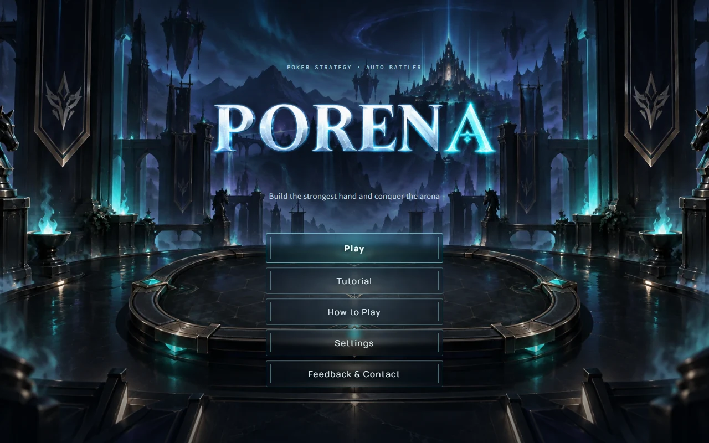
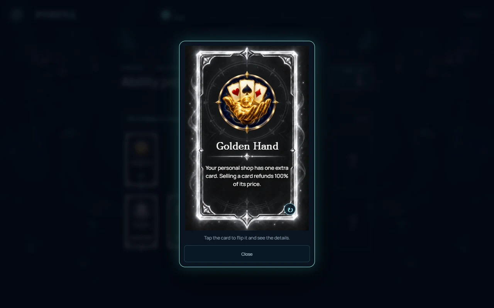
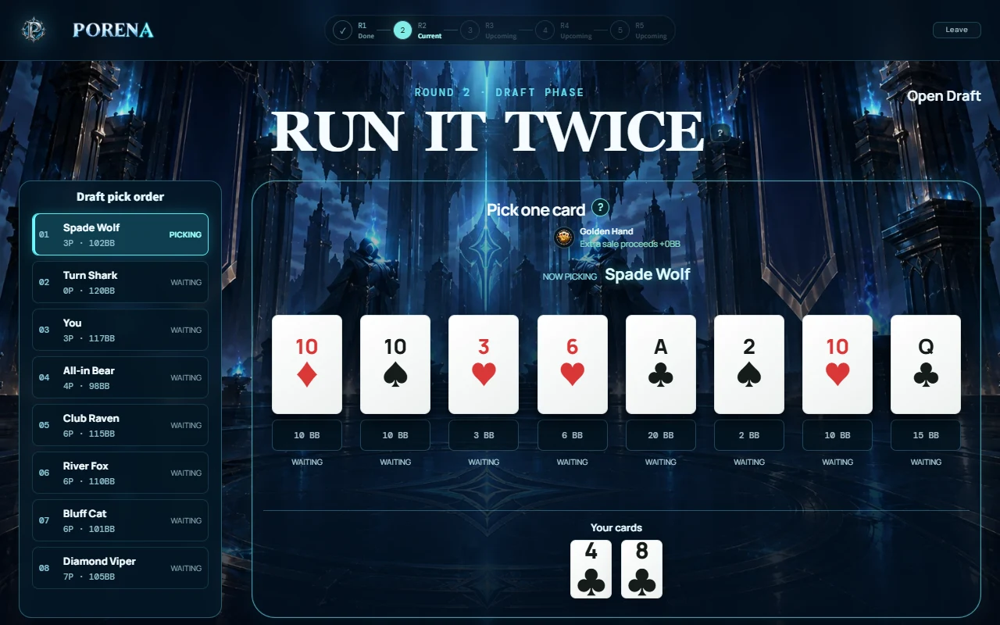

# PORENA

[한국어](README.md) · **English**

> **Tactical Poker Autobattler**



**Design your hand. Rule the arena.**

PORENA is not poker where you wait for good cards. Eight players share **a single 52-card pool**, buying, selling, drafting and bidding for the cards they need to design their own hand. The poker rules change every round, and the points collected over six rounds plus the final decide the winner.

**[▶ Play now](https://porena.kr)** · [GitHub](https://github.com/wlghks4689/holto-chess)

> **Status:** development prototype, playable online · preparing a full Steam (Windows) release · Discord Activity supported
> **Players:** 2–8 humans · AI fills empty seats, so every game has eight
> **Server:** Cloudflare Workers + Durable Objects + WebSocket
> **Languages:** 한국어 · English (picked from your browser language, changeable in Settings)

The in-game **How to Play** has two paths: the *Beginner guide* if you are new to poker, and the *Rule book* if you want rules and numbers right away. This README follows the same order.

---

## New here? — the 5-minute version

1. **Get an ability.** When the game starts you are dealt one of 12 at random: your own special power.
2. **Collect cards.** Buy cards from your shop with BB, or take them from the open draft and the card auction. A card someone owns cannot be owned by anyone else.
3. **Fight under each round's rules.** Matches are decided by the poker hand of your best five cards (BEST 5).
4. **Earn points and BB.** Two players leave in R3 and in R4, and one more in R5.
5. **After the R6 final, the final score decides the winner.**

```text
R1 8 ─ R2 8 ─ R3 8→6 ─ R4 6→4 ─ R5 4→3 ─ R6 final standings (three-way final)
                ▲ 2 out   ▲ 2 out   ▲ 1 out
```

| Round | In one line |
| --- | --- |
| **R1 HOLD'EM SWISS** | Your 2 cards + a 5-card board. Three familiar Hold'em matches |
| **R2 RUN IT TWICE** | Draft a third card; in each run, BEST 5 from all three of your cards + a 5-card board · two matches against different opponents |
| **R3 AUCTION · OMAHA SWISS** | Win a fourth card in a 16-card auction, then use exactly 2 of your cards + 3 board cards. Eliminations begin |
| **R4 BEST FIVE OF TEN** | Your 5 cards + a 5-card board. Split into a winner bracket and a survival bracket |
| **R5 RUN IT THREE TIMES** | The leader picks an opponent; split six cards into three two-card hands for three runs. The lowest player leaves |
| **R6 THE LAST HAND** | Field five of your 5–7 cards; BEST 5 with a five-card community board. The three-way final |

```text
Final score = round points + R6 hand score + ⌊remaining BB ÷ 10⌋
```

Points and BB earned from abilities are not added separately; they are already in the formula above.

---

## Rule book

Every number comes from the game code (`holto-chess/src/game/config.ts`, `engine.ts`, `abilities.ts`), and the in-game rule book reads the same values straight from the code.

### 1. Basics

| Item | Value |
| --- | --- |
| Players | 8 · AI fills empty seats |
| Card pool | 52 unique cards, shared |
| Start | 50BB · no starting cards (buy your two R1 cards in the shop) · one ability |
| Round income | +30BB to every survivor at the start of R2–R6 |
| Shop cards | R1 3 · R4 2 · R5 3 · R6 4 (no shop in R2 and R3) |
| Reroll / lock | 5BB / 3BB (a lock keeps a card through that shop's rerolls only; it never carries into the next round's shop) |
| Sell refund | 60% of the base price (rounded down) |

| Round | R1 | R2 | R3 | R4 | R5 | R6 |
| --- | ---: | ---: | ---: | ---: | ---: | ---: |
| Cards held | 2 | 3 | 4 | 5 | 6 | 5–7 (field 5) |
| Card source | Shop | Open draft | Card auction | Draft → shop | Shop | Shop |
| Purchase limit | 2 | — | — | 3 | 3 | 5 |
| Reroll limit | 1 | — | — | 2 | 2 | 2 |

**Card prices (BB)** — A 20 · K 18 · Q 15 · J 12 · T 10 · 9 to 2 cost their rank (9BB to 2BB)

### 2. Shared card pool

- Each of the 52 cards exists once. A card someone owns never appears in anyone else's shop, draft or auction.
- A card in your shop is also unavailable to everyone else while it sits there.
- Sold cards and the cards of eliminated players return to the pool.
- Opponents' cards stay hidden until a showdown reveals them. Board cards never overlap the cards owned by that match's players.

### 3. Economy (match BB rewards)

| Match | Win | Loss |
| --- | --- | --- |
| R1 | 0 | +10 (+5 × losing streak) → 10 · 15 · 20 |
| R2 run | 0 | 0 |
| R3 | 0 | +10 (+5 × losing streak) → 10 · 15 · 20 |
| R4 · R5 · R6 | 0 | 0 |

Match BB goes only to the loser. Wins pay in points, and a split only shares points. The losing streak counts losses earlier in the same round and resets every round. A forfeit for lacking cards pays neither points nor BB.

### 4. Rounds

| Round | Players | Cards | Matches | Points | Rule | Elimination |
| --- | ---: | ---: | --- | --- | --- | --- |
| **R1** Hold'em Swiss | 8 | 2 | 1:1 Swiss ×3 | Win +3P · split +1P | BEST 5 of 2 hole + 5 board | None |
| **R2** Run It Twice | 8 | 3 | Draft → 1:1 match ×2 (2 runs each) | Per run: win +2P · split +1P · match sweep +2P | BEST 5 of your 3 + 5 board | None |
| **R3** Auction · Omaha Swiss | 8 | 4 | Card auction → 1:1 Swiss ×3 | Win +4P · split +2P | Exactly 2 hole + exactly 3 board | Lowest 2 by points |
| **R4** Best Five of Ten | 6 | 5 | Draft → shop → first match → 3-player groups | First match win +6P · split +3P | BEST 5 of 5 hole + 5 board | 2 from the survival group |
| **R5** Run It Three Times | 4 | 6 | Opponent pick → shop → 1:1, 3 runs | Run win +5P · split +2P · 3–0 +15P | Per run: 2 hole + a new 5-card board | Lowest 1 by points |
| **R6** The Last Hand | 3 | Field 5 of 5–7 | Shop → lineup → three-way | +30 / +10 / +0P | BEST 5 of your five + 5 board · other cards shown as BURN | Final standings |

- **R1** — Once you hold two cards, their rank among all 169 Texas hold'em starting hands shows as **Power rank #N** (eight-handed equity; #1 AA, #169 72o). The higher the rank, the hotter the flame.
- **R2** — No personal shop. Both runs use all three of your cards; any number of them (0–3) can make the BEST 5. The two runs use different boards. After the draft, a 15-second R2 briefing appears; once everyone confirms, the matches start. Your first opponent is someone you did not meet in R1; your second is a similar-scoring player you met neither in R1 nor in the first match.
- **R3** — A 16-card auction (40 seconds, extended by bids in the last 5 seconds, 55 seconds at most); each player wins at most one card. The first bid is the base price; a competing bid must beat the current price by 5BB or more. Bidding on another card cancels your previous bid. Players who win nothing buy one leftover card at double price in draft order (no ability discount; it sells at its base price). The first match is seeded by points (BB on ties).
- **R4** — The three first-match winners form the winner group (1st +10P · 2nd +5P · 3rd +3P; tied seconds get +3P each); the three losers form the survival group (only 1st survives, +0P).
- **R5** — The leader (points, then BB) picks an opponent (15 seconds; 4th place if no pick); the other two face each other. Fill your hand to exactly six cards in the shop and place two per run (30 seconds; a recommended placement on timeout). Any split cancels the 3–0 bonus.
- **R6** — Reach 5–7 cards in the shop (auto-buy up to five on timeout) and set your five (your strongest five are pre-placed; swap within 10 seconds). Tied places share their points by remaining BB (ICM).

### 5. Open draft (R2 · R4) and the R3 double-price buy

R2 reveals 8 cards and R4 reveals 16; each player takes one and pays its price in BB. Players who won nothing in the R3 auction buy their double-price card in the same order.

Pick order:

1. The **First Class** ability holder
2. Players with **fewer** points
3. On equal points, players with **more** BB
4. Still tied: random

### 6. Elimination

- **R3**: after three matches, the two lowest by points leave. A tie on the cut line goes to a **survival tiebreak** on fresh boards (no points or BB; BB does not break the tie). If three boards all tie, a random rank draw decides.
- **R4**: only the winner of the three-player survival group stays; two leave.
- **R5**: the lowest by points leaves. Equal points: fewer BB leaves; equal BB too: a fresh-board tiebreak with RUN 1→2→3 cards, then a high-card draw.
- Eliminated players' cards return to the pool, and their placement is fixed by their points at elimination.

### 7. Final score and standings

```text
Final Score = round points + R6 Hand Score + floor(remaining BB / 10)
```

| Hand | High card | Pair | Two pair | Trips | Straight | Flush | Full house | Quads | Straight flush | Royal flush |
| --- | ---: | ---: | ---: | ---: | ---: | ---: | ---: | ---: | ---: | ---: |
| Score | 0 | 1 | 2 | 5 | 8 | 12 | 15 | 20 | 35 | 50 |

- The three R6 finalists take 1st–3rd by final score. On equal scores, the better R6 final placement ranks higher.
- The R5 leaver is 4th, R4 leavers 5th–6th, R3 leavers 7th–8th, ordered by points at elimination. BB and hands never move a player across these bands.
- The **rank points** on the results screen (+8 / +4 / +2 / 0 / −1 / −2 / −4 / −8) only label places 1–8 and are not added to the final score.

### 8. Abilities

When the game starts each player is dealt one of 12 at random, and all eight abilities differ. For the first 5 seconds you see only your own; then everyone's abilities are revealed. Match-reward abilities trigger only in **regulation matches**; tiebreak boards never pay rewards.

| Ability | Effect | When · notes |
| --- | --- | --- |
| **Royal Blood** | Get one free starting card from A·K·Q·J·T; buy that rank at 50% (rounded down) in shops and drafts | e.g. Q 15BB → 7BB |
| **Target Sniper** | Get one random free card at the start of R1. Winning a regulation match outright with it in your BEST 5 pays +15BB | Any hand counts · no splits or post-split tiebreak wins · per run in R2 and R5 · off when you sell the card, back on if you buy it again |
| **Underdog** | In the R6 final, a straight or better whose BEST 5 includes a 2 pays +20P | Win or lose · never triggers in R1–R5 |
| **First Class** | Always picks first in the R2 and R4 open drafts and the R3 double-price buy | No advantage in R3 auction bidding |
| **Golden Hand** | +1 personal shop card; selling refunds 100% of the base price | R2 and R3 have no personal shop |
| **Trader** | Free personal-shop rerolls and locks, +1 reroll each shop phase | Not in R2 and R3 |
| **Predator** | Each outright regulation win adds 1 to your streak; from a 2-win streak each win pays streak × 5BB (10 · 15 · 20 …) | The streak carries across rounds · resets on a split or loss · tiebreak wins excluded |
| **Architect** | A regulation match whose final hand is exactly a full house pays +30BB | Win or lose · per run in R2 and R5 · quads or better excluded |
| **Capitalism** | At the end of each round you survive, get 20% of your BB (rounded down) | Once per round · not in the round you are eliminated · also after R6 |
| **QUAD CORE** | Quads in the R6 final double your final placement points | Quads from any cards count · only placement points double · quads in R1–R5 excluded |
| **Front Runner** | Leading at the end of a round pays R1 +3 · R2 +4 · R3 +5 · R4 +6 · R5 +7 · R6 +8P | R1–R5: the single survivor-table leader (points → BB → seat) · R6: final 1st place, all tied firsts paid |
| **Protector** | Losing an R1–R5 1:1 regulation match you were favored in (60%+) pays by tier: 60%+ +20 · 70%+ +30 · 80%+ +50BB | Uses the win chance shown before the match (rounded down) · per run in R2 and R5 · not splits, R6 or tiebreaks |

### 9. Ties · exceptions

- Equal hands compare kickers. Suits never break ties; identical hands split.
- A split first match in R4 gives both players +3P; only the group assignment is replayed on fresh boards (up to 2, then a random rank draw). That decider pays no extra points.
- A tie in the R4 winner group replays only first place. Tied seconds get +3P each.
- A split R5 run gives both players +2P, and any split cancels the 3–0 bonus.
- Tied R6 places share those places' points by remaining BB (ICM).
- Lacking the required number of cards forfeits that match (no points or BB). No free cards, forced refills or BB debt. In R5 and R6, a timeout auto-buys the missing cards from your own shop to prevent forfeits.
- When a time limit ends, the server completes unfinished actions so the game never stalls.

### 10. Timing (server-synchronized)

These are the server-managed maximum waits. Some phases advance early once every required player confirms; showdown cinematics run separately depending on the number of matches and tiebreaks.

| Phase | Limit | Behavior |
| --- | ---: | --- |
| Ability deal | 5s | Each player sees only their own ability (auto-advance) |
| Ability reveal | 30s | Moves to the shop once everyone is ready |
| Shop | 60s | Unfinished seats are readied when time runs out |
| Draft order · deal-in | 3s | Every seat sees the same deal animation before picks start |
| Open draft pick | 20s per player | AI picks every 1.8s · auto-pick on timeout |
| Draft results | 3.5s | Shows every pick after the last one, then moves on |
| R2 briefing | 15s | Matches start as soon as everyone confirms |
| R3 auction | 5s briefing + 40s bidding (max 55s) | 5s results · double-price buy 10s per player |
| Showdown matchup sync | 3.5s | Shows the matchup and win chances, syncs with the opponent, then starts |
| R4 bracket review | 10s | Review the winner and survival groups |
| R5 opponent pick | 15s | 4th place picked on timeout · 3s pairing reveal |
| R5 run placement | 30s | Unfinished placements use the recommendation |
| R6 lineup | 10s | Your strongest five are pre-placed |
| Round results | 30s | Moves on after the results |
| Next round · survival tiebreak prep | 30s | The server handles seats that do not respond |
| Showdown cinematic | Varies | Card reveal, BEST 5, results and rewards. Between matches the result stays 3s before the next matchup (3.5s) |

---

## Screenshots

**Ability Deal** — When the game starts you are dealt one ability at random. Tap the card to flip it and read the full rules.



**Open Draft** — Players take the revealed cards one at a time, lowest points first. Everyone can see who took which card.



---

## Tech Stack

- React + TypeScript + Vite
- Cloudflare Workers · Durable Objects · WebSocket
- Vitest (including `@cloudflare/vitest-pool-workers`) · ESLint

```text
Browser (React UI)
      ↓  WebSocket
Cloudflare Worker
      ↓
Durable Object (one instance per room, SQLite storage)
```

---

## Multiplayer Architecture

The server holds the authoritative state. Clients only request actions and draw the `PlayerView` they receive.

| Client | Server |
| --- | --- |
| Action requests (buy / draft / ready) | Card ownership and pool integrity |
| PlayerView rendering | Board generation · showdown judging · BEST 5 |
| Cinematic playback | Points / BB / eliminations / final standings |

- **Hidden information stays hidden:** opponents' hole cards and shops are never in the payload. Only cards revealed at showdown are sent.
- **Reconnects:** a session token returns you to the same seat, and any running cinematic resumes from the current moment.
- **Guaranteed progress:** every phase has a time limit and auto-advance (see the timeline above). When time runs out the server acts for unfinished seats, so no single player can stall a room.
- **Synchronized presentation:** the server sets when each showdown cinematic starts and ends, so every seat sees the same scene at the same time and reaches the results together.
- **Spectating and rematches:** eliminated players can keep watching, and the same room can start a rematch when the game ends.

---

## Project Structure

```text
holto-chess/
├─ src/
│  ├─ core/     # cards and poker evaluation (hands · BEST 5)
│  ├─ game/     # game rules, room state, balance values, bots
│  ├─ shared/   # client/server protocol and cinematic timeline
│  ├─ i18n/     # Korean · English text
│  ├─ admin/    # feedback inbox for the operator
│  └─ ui/       # React screens, showdown cinematics, How to Play
├─ worker/      # Cloudflare Worker + Durable Object
├─ tools/       # balance simulator, operations scripts
└─ public/      # background art and other static assets
```

---

## Run Locally

```bash
npm install
npm run dev
```

Build · test · deploy:

```bash
npm run build
npm test
npm run test:workers
npm run deploy
```

Every command at the repository root forwards to `holto-chess/`. The app layout and development principles are in [holto-chess/README.md](holto-chess/README.md) (Korean).

### Balance simulator

Plays complete eight-player games through the real game engine instead of re-implementing the rules, and reports results by policy, seat, draft order, card, economy, score breakdown and ability, with confidence intervals.

```bash
cd holto-chess
node tools/balance-simulator/run.mjs --games 200 --jobs 4                         # current rules
node tools/balance-simulator/run.mjs --games 200 --set rankPrices.14=15 --compare # before/after a value change
node tools/balance-simulator/run.mjs --games 2000 --abilities --policies ABILITY_AWARE --rows --jobs 8
```

See [tools/balance-simulator/README.md](holto-chess/tools/balance-simulator/README.md) (Korean) for every option.

---

## Development Status

### Implemented
- [x] R1–R6 game loop
- [x] Shared 52-card pool
- [x] Multiplayer rooms · invite links · reconnects
- [x] Open Draft (R2 · R4)
- [x] Omaha Swiss (R3)
- [x] Showdown cinematics · server-synchronized presentation
- [x] R3 card auction · R5 opponent pick · R6 three-way final
- [x] Spectating after elimination · rematches
- [x] 12 abilities · dealt at random when the game starts
- [x] How to Play split into a beginner guide and a rule book
- [x] Korean · English
- [x] Discord Activity
- [x] Made-hand sound effects · volume settings
- [x] Pre-showdown win chance
- [x] Feedback form and operator inbox
- [x] Multiplayer match history saved on the device (last 20)
- [x] Engine-based balance simulator · per-ability win rates

### In Progress
- [ ] Balance tuning
- [ ] Better AI strategy
- [ ] BGM
- [ ] Rankings · accounts
- [ ] Steam (Windows) build

---

## Design Philosophy

PORENA is not a copy of Texas Hold'em.

- It gives **choices** more weight than luck.
- It turns the cards themselves into **strategic resources** you buy and sell.
- It changes the poker rules every round so no single best strategy settles in.
- It aims for a new experience somewhere between poker and auto battlers.

---

## Roadmap

- Value tuning based on balance simulations
- Stronger AI strategy
- More BGM and sound design
- Accounts and rankings
- Steam build

---

## License

This is a private project at the prototype stage. Until a license is granted, all rights are reserved by the creator.

Bug reports · feedback · questions: **Feedback & Contact** on the game's start screen

