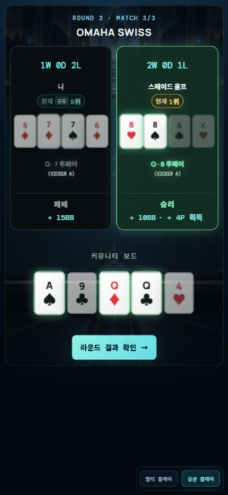

# 쇼다운 프로필·결과 영역 QA — 2026-09-29

## 원인과 수정

프로필에 닉네임·현재 순위·승패를 좁은 고정 행으로 모두 쌓아 카드와 가까워지고 정보 우선순위가 섞였다. 승패를 공통 하단 결과 영역으로 이동해 첫 줄에 표시하고 BB·승점은 둘째 줄에 유지했다. 닉네임과 순위는 최신 지시에 따라 행 간격2px로 묶고, 모바일 카드와의 외부 여백은12px로 분리했다. 기존 대비 총 높이는 유지한다.

R3 플레이어 카드 랭크·문양을 직전 수정보다 추가1px 확대했다. 카드 외곽 크기 및 보드 글꼴은 변경하지 않았다. 결과 공개 플래그, 게임 상태, 승패 판정, 보상 값은 변경하지 않았다. R5의 최종 등수 스탬프는 유지했다.

## 검증

- 실제 진행 중인 R3 Match3 화면375×811: 문서 높이811px, 스크롤 없음. 프로필 높이46px/행 gap2px/카드 쪽 margin12px. 하단 승패와 보상은 분리된 두 줄.
- 360×780: 8개 쇼다운 fixture 상태를 검사한 뒤 최신 순위 간격 수정 후 R2완료/R3/R4삼자 상태를 재검사. 페이지 스크롤·카드 정착 겹침·진행 버튼 이탈 없음.
- 402×874: R1완료, RUN1결과, RUN2리버, R2완료, R3완료, R4삼자, R4헤즈업, R5최종 8개 상태 검사. 페이지 스크롤 없음. R5 등장 애니메이션 중 겹침 보고가 있었으나 종료 후 재검사0건. 다른 상태도 issues0건.
- 1280×900: R2완료/R3완료/R4삼자 검사 모두 issues0건/문서 높이900px.
- R1~R4 결과 표시 단계는 프로필 승패0개, 하단 승패 각 좌석1개. RUN2리버는 결과를 조기 노출하지 않는다. R4 모바일5장은3+2 유지.
- 기존 cinematicRendering 테스트40개 통과. TypeScript/ShowdownCinematic ESLint/클라이언트 및 Worker 빌드 통과. 최신 추가 변경은 CSS 간격만이며 위 브라우저 검수로 확인했다.
- 실제 Safari/iPhone 실기기 및 모든 게임의 처음부터 끝까지 플레이는 검증하지 않았다.

## 글꼴 실측과 문의 답변

375×811 실제 R3에서 커뮤니티 보드 랭크16.2641px/문양21.8403px, 플레이어 카드 랭크12.54px/문양15.64px. 공통 compact 글꼴은 랭크 `clamp(12px,35cqw,20px)`, 문양 `clamp(16px,47cqw,26px)`로 카드 내부 가용 폭에 비례한다. R3 모바일에는 별도 확대 규칙이 적용된다.

카드 외곽 치수와 내부 font-size는 독립적으로 설정할 수 있다. 전체 라운드에 보드 글꼴을 그대로 적용하면5장/7장의 좁은 카드에서 과밀해질 수 있다. 이번 요청은 가능 여부 문의이므로 보드와 플레이어의 글꼴 통일은 추가 적용하지 않았다.

## 2026-10-13 후속 검수 — R1 족보 위치·R2/R5 RUN 상세 카드

사용자 요청: R1 족보를 내 카드와 하단 테두리 사이의 가운데로 옮기고, 완료된 R2/R5 RUN 상세 카드의 랭크·문양을 카드 크기에 맞게 확대한다. 기준 checkout은 `main`의 `0707ed3`. 소스 변경은 `holto-chess/src/ui/six-round.css`에 한정했으며 판정·보상·공개 시점·재생 타임라인과 상세보기 클릭/호버 동작은 변경하지 않았다. 구현·검수 후 사용자가 이번 수정의 `main` 커밋·푸시를 승인했다. 수동 Worker 배포는 실행하지 않으며, 푸시로 시작되는 자동 빌드 상태는 별도로 확인한다.

### 원인과 보정

- PC R1은 홀카드 행의 `flex:1`이 여백을 모두 차지해 족보가 패널 바닥으로 밀렸다. 카드 영역과 아래 읽기 영역을 3:2로 나누고 족보를 아래 영역의 가운데에 배치했다. 패널 하단 padding의 절반을 보정해 카드 하단과 외곽 테두리 사이 중간점에 맞춘다. 결과 footer는 이 flex 계산에서 제외해 결과 공개 때문에 족보·카드가 이동하지 않도록 했다.
- 낮은 PC 창에서는 족보/키커와 승패/보상이 겹치지 않게 R1 footer 간격을 줄이고 프레임 최소 높이 640px을 확보했다. 높이가 부족하면 세로 스크롤을 허용한다. 모바일의 기존 좌석 배치는 유지한다.
- RUN 상세는 공통 30px, R2 25px, 모바일 25px, PC RUN 상자 높이 기반 계산이 서로 경쟁했다. 글자는 별도의 10/12/14px 규칙을 사용했고, glow 카드는 1.025배 커져 다른 카드와 외곽 크기도 달랐다.
- 공통 `--run-detail-card-width`에서 카드 높이(53:75), 랭크(폭의 44%), 문양(폭의 58%), 카드 간격과 두 줄짜리 상세 상자 높이를 계산한다. 상세 카드의 scale은 제거하되 glow·dim 색상은 유지한다. PC 완료 RUN은 같은 높이를 예약하고, 상세 상자는 명시적인 공통 높이를 사용해 RUN 경계선의 1px 차이도 내부 규격에 영향을 주지 않게 했다.

### 브라우저 실측

실제 `innerWidth/innerHeight`를 확인한 로컬 미리보기에서 측정했다. R1은 실제 엔진 R1 결과를 `/phase-preview`의 FLOP_HAND/REWARD 프레임으로 고정했고, R2는 `/run-twice-preview`, R5는 실제 6라운드 엔진을 사용하는 `/run-three-preview`(8자 한국어·긴 영어 닉네임)로 확인했다.

- R1 1440×900: 카드 하단 611.59px, 좌석 테두리 하단 872.98px, 중간점과 족보 영역 중심 모두 742.29px. 1366×768과 1280×650에서도 중심 오차 0.01px 이내. 보상 공개 상태의 1280×650, 1200×600, 1200×560에서 족보/키커와 결과 footer 겹침 없음. 모바일 390×844의 진행 중 족보 중심 오차는 기존 배치에서 0.5px.

| R2/R5 공통 viewport | 상세 카드 폭 | 랭크 | 문양 | 상세 상자 높이 |
| --- | ---: | ---: | ---: | ---: |
| 1440×900 | 43.19px | 19.01px | 25.06px | 148.25px |
| 1280×650 | 31.19px | 13.73px | 18.10px | 114.30px |
| 768×1024 | 30px | 13.2px | 17.4px | 110.89px |
| 390×844 | 31.19px | 13.73px | 18.10px | 110.30px |
| 375×667 | 30px | 13.2px | 17.4px | 106.89px |

각 상세보기의 홀카드 4장과 보드 5장 모두 같은 외곽 크기였고 카드 잘림·가로 넘침은 없었다. R5 1440×900에서 RUN 3 진행 중의 완료 RUN 1/2와 최종 완료 후 RUN 1/2/3은 카드 폭 43.19px, 상자 높이 148.25px로 동일했다. R2는 두 RUN 완료 및 모바일 탭 열기 동작을 확인했다.

### 자동 검사와 범위

`npm test -- src/ui/cinematicRendering.test.ts src/ui/cinematicTimeline.test.ts src/ui/showdownStage.test.ts`: 3파일/56테스트 통과. 최종 CSS로 `npm run build` 및 `git diff --check` 통과. 빌드의 기존 로컬 인증 secret·대형 client chunk 경고는 남아 있다. 실기기 Safari/iOS/Android 및 온라인 경기 전체 완주는 이번 검사 범위 밖이며, 고정 프레임 검사로 승률 계산 성능이나 전체 전환 성능을 검증했다고 주장하지 않는다. 결과 이미지는 현재 채팅의 `r1-hand-label-desktop.jpg`, `r5-run-detail-desktop.jpg`, `r5-run-detail-mobile.jpg`로 보존했다.
